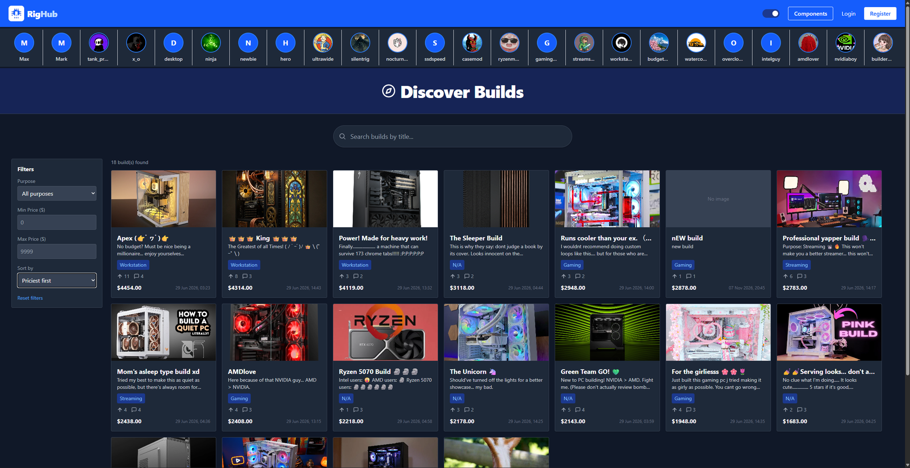
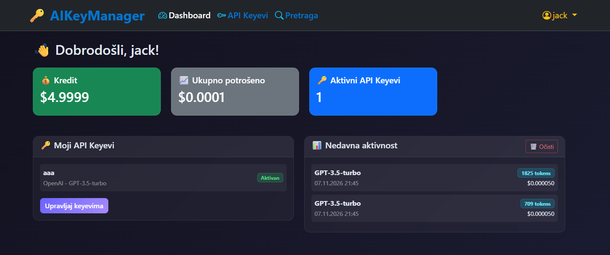

# Hi, I'm Ognjen 👋

I’m a Computer Science student at the University of Montenegro who loves building full-stack apps.  
  
I like turning complex ideas into simple projects. 🌝

  

I'm currently learning about software architecture and backend engineering, and experimenting with open-source LLMs locally.

  

---

### 🚀 Featured Projects

**[RigHub](https://github.com/ogi122/RigHub)**  
A community hub for showcasing, exploring, and rating custom PC builds.
- **Frontend:** React, Vite, and Tailwind CSS
- **Backend:** Express & MySQL featuring JWT auth and media upload handling
- Interactive upvote/downvote system for community builds

 

  

 

---

**[AIKeyManager](https://github.com/ogi122/AIKeyManager)**  
A simulation platform for managing API keys for AI models: generate keys per model, simulate requests, and track credit and usage.
- Built with **ASP.NET Core MVC** and **Entity Framework Core**
- Handled schema design and database logic with **SQL Server** (custom triggers, functions, and stored procedures)
- Implemented cookie-based authentication with role-based permissions (Admin/User)

 

  

 

---

### 🎮 Other Work

**[Ragdoll on Skates](https://www.roblox.com/games/15178090225)**   

Co-created a Roblox ragdoll game that has hit **45M+ total visits**. I handled level design, environment artwork, and Lua scripting for traps and similar elements.

  
  

---

### 🛠️ Tech Stack

  
  
  
  
  
  
  
  
  
  
  
  
  
  
  

---

### 🧪 Currently Exploring

* Open-source & local LLMs (Hugging Face, local runtime workflows)
* Scalable software architecture patterns
* Modern React features & patterns

---

### 📫 Let's connect

[LinkedIn](https://www.linkedin.com/in/ognjen-stojanović122)
